# TED Sanctuary — Database Design

Single-tenant personal app for two accounts: **Smadar** (recipient, role `recipient`)
and **Toluwani** (creator/admin, role `admin`). Every "content" table hangs off
`users.id` so the schema stays correct even though there's effectively one
real "owner" — no multi-tenant scaffolding (no `tenant_id`, no `organizations`,
no `teams`).

## 1. Every piece of data the UI implies

Walking the components file by file:

- **AestheticIntro / TedHeroGreeting** → a greeting needs to know time-of-day and
  needs a rotating quote pool, and logs each greeting/chat turn somewhere →
  `ted_interactions`.
- **TedCompanion (chat)** → conversation history + what TED has learned about
  Smadar over time → `ted_interactions` (log) + `ted_memories` (extracted facts).
- **HomeExperience** → mood check-in → `mood_entries`; dual clocks (Abuja/Montreal)
  → derived from `users.timezone`, not its own table; "today's memory" → derived
  by querying `memories`, not stored; recommended songs → `songs` (+ `playlists`).
- **data.ts `MEMORIES`** → `memories` table (title, description, detailed_story,
  category, heart_color, date label vs. real date).
- **data.ts `LETTERS`** and **OpenWhenLetters.tsx** → one `letters` table covering
  both birthday letters and "open when" trigger letters (a `type` column
  distinguishes them instead of two near-identical tables).
- **AcrosticSection** → `acrostic_entries` (small, ordered, editable content —
  currently hardcoded in the component, but it's user data about Smadar's name).
- **OurStorySanctuary** (photos/videos/voice notes, timeline, time capsules,
  future dreams) → `media` (polymorphic), `time_capsules`, `future_dreams`,
  `important_dates`.
- **Care tab (period tracking, mood history, TED insights)** → `period_logs`,
  `cycle_predictions` (a derived/cached table, regenerated whenever a new log
  lands — insights are *computed*, not stored separately), `mood_entries`
  (shared with Home).
- **Settings** → `settings` (key/value, per user, so new toggles never need a
  migration).
- **Notifications/reminders** (daily greeting nudge, period reminders, letter
  unlock reminders) → `notifications`.

## 2. Design principles applied

- **UUID primary keys** everywhere (`$table->uuid('id')->primary()`) — safe to
  reference in URLs/share-links without leaking sequential IDs, and trivially
  portable if this ever needs to sync across devices offline-first.
- **Every table has `created_at`/`updated_at`**; log-style tables
  (`ted_interactions`, `notifications`) still get both even though they're
  append-mostly, for consistency and auditability.
- **No duplication**: `cycle_predictions` and TED insights are *derived* from
  `period_logs` / `mood_entries` — only the prediction's own output (dates,
  confidence) is stored, not a copy of the raw logs.
- **Polymorphic `media`** table instead of `memory_photos`, `letter_photos`,
  `time_capsule_photos` — one table, indexed on `(mediable_type, mediable_id)`.
- **`settings` as EAV (key/value + JSON)** rather than dozens of nullable
  boolean columns on `users` — new settings ship without a migration.
- **`ted_memories` as EAV** for the same reason: what TED "learns" about
  Smadar is open-ended and will keep growing; a rigid column-per-fact schema
  would require migrations forever.
- Every FK is `constrained()->cascadeOnDelete()` where the child is meaningless
  without the parent (e.g. `media` without its `memory`), and
  `nullOnDelete()` where the child should survive (e.g. a `song` added by a
  user who's deleted shouldn't vanish).

## 3. Entity Relationship Diagram

```mermaid
erDiagram
    USERS ||--o{ TED_MEMORIES : "has facts learned"
    USERS ||--o{ MOOD_ENTRIES : logs
    USERS ||--o{ PERIOD_LOGS : logs
    USERS ||--o{ CYCLE_PREDICTIONS : "generated for"
    USERS ||--o{ MEMORIES : owns
    USERS ||--o{ LETTERS : receives
    USERS ||--o{ IMPORTANT_DATES : owns
    USERS ||--o{ TIME_CAPSULES : owns
    USERS ||--o{ FUTURE_DREAMS : owns
    USERS ||--o{ PLAYLISTS : owns
    USERS ||--o{ SONGS : "added by"
    USERS ||--o{ TED_INTERACTIONS : participates
    USERS ||--o{ NOTIFICATIONS : receives
    USERS ||--o{ SETTINGS : configures

    MEMORIES ||--o{ MEDIA : "cover / gallery"
    LETTERS ||--o{ MEDIA : attachments
    TIME_CAPSULES ||--o{ MEDIA : attachments

    MOOD_ENTRIES ||--o{ TED_INTERACTIONS : "referenced by"

    PLAYLISTS ||--o{ PLAYLIST_SONG : contains
    SONGS ||--o{ PLAYLIST_SONG : "included in"

    USERS {
        uuid id PK
        string name
        string email UK
        string password
        enum role
        string timezone
        string city
        date birthday
        timestamp created_at
        timestamp updated_at
    }
    TED_MEMORIES {
        uuid id PK
        uuid user_id FK
        string category
        string key
        text value
        float confidence
        enum source
        timestamp last_referenced_at
    }
    MOOD_ENTRIES {
        uuid id PK
        uuid user_id FK
        string mood
        string emoji
        text note
        date entry_date
        tinyint energy_level
    }
    PERIOD_LOGS {
        uuid id PK
        uuid user_id FK
        date start_date
        date end_date
        enum flow_intensity
        json symptoms
    }
    CYCLE_PREDICTIONS {
        uuid id PK
        uuid user_id FK
        date predicted_start_date
        date predicted_end_date
        date predicted_ovulation_date
        smallint average_cycle_length
        timestamp generated_at
    }
    MEMORIES {
        uuid id PK
        uuid user_id FK
        uuid cover_media_id FK
        string title
        string slug UK
        string date_label
        date memory_date
        enum category
        string heart_color
        boolean is_featured
    }
    MEDIA {
        uuid id PK
        string mediable_type
        uuid mediable_id
        enum type
        string file_path
        string thumbnail_path
        string caption
        int duration_seconds
        smallint sort_order
    }
    LETTERS {
        uuid id PK
        uuid user_id FK
        enum type
        string trigger_label
        string title
        text content
        string signature
        timestamp unlock_at
        timestamp opened_at
        int open_count
    }
    IMPORTANT_DATES {
        uuid id PK
        uuid user_id FK
        string title
        date event_date
        boolean is_recurring
        smallint reminder_days_before
    }
    TIME_CAPSULES {
        uuid id PK
        uuid user_id FK
        string title
        text message
        date unlock_date
        boolean is_unlocked
        timestamp unlocked_at
    }
    FUTURE_DREAMS {
        uuid id PK
        uuid user_id FK
        string title
        text description
        date target_date
        enum status
    }
    SONGS {
        uuid id PK
        string title
        string artist
        enum provider
        string external_url
        text note
        uuid added_by FK
    }
    PLAYLISTS {
        uuid id PK
        uuid user_id FK
        string name
        text description
    }
    PLAYLIST_SONG {
        uuid id PK
        uuid playlist_id FK
        uuid song_id FK
        smallint position
    }
    TED_INTERACTIONS {
        uuid id PK
        uuid user_id FK
        uuid mood_entry_id FK
        enum sender
        text message
        enum interaction_type
        json context_used
    }
    NOTIFICATIONS {
        uuid id PK
        uuid user_id FK
        string type
        string title
        text body
        enum channel
        timestamp scheduled_at
        timestamp sent_at
        timestamp read_at
    }
    SETTINGS {
        uuid id PK
        uuid user_id FK
        string key
        json value
    }
    ACROSTIC_ENTRIES {
        char letter
        string word
        string badge
        text story
        smallint sort_order
    }
```

## 4. Table-by-table explanation

| Table | Purpose |
|---|---|
| `users` | The two people who can log in: Smadar (`recipient`) and Toluwani (`admin`). Holds identity, city/timezone (drives the dual-clock widget), avatar, birthday. |
| `ted_memories` | Everything TED "learns" — favorite drink, a stressor she mentioned, a routine. EAV-style (`category`/`key`/`value`) so the AI can write new facts without a migration. `source` tracks whether it came from a chat, a manual entry, or was inferred from mood data. |
| `mood_entries` | One row per daily check-in. Unique on `(user_id, entry_date)` — only one check-in per day. Feeds both the Home mood widget and Care's mood history/TED insights. |
| `period_logs` | Raw cycle data: each period's start/end, flow, symptoms (JSON — flexible, no symptom-table explosion). |
| `cycle_predictions` | The *output* of a prediction algorithm run over `period_logs` — next start date, ovulation estimate, confidence. Regenerated (upserted) whenever a new `period_logs` row is added; never hand-edited. |
| `memories` | "Our Story" timeline entries — title, story, category, the poetic `date_label` shown in the UI *and* a real `memory_date` for sorting. `cover_media_id` points at the hero image. |
| `media` | Polymorphic photo/video/voice-note store, attachable to a `memory`, `letter`, or `time_capsule` via `mediable_type`/`mediable_id`. One table instead of three near-identical ones. |
| `letters` | Both the birthday letters and the "Open When…" envelopes — `type` (`birthday` \| `open_when` \| `custom`) plus `trigger_label` for the envelope's condition. `opened_at`/`open_count` let you show "she's read this" without a separate log table. |
| `important_dates` | Anniversaries, first-call date, etc. — separate from `memories` because these are forward-looking reminders (recurrence + reminder lead time), not stories. |
| `time_capsules` | Sealed messages with an `unlock_date`; `is_unlocked` flips once that date passes (checked by a scheduled job). |
| `future_dreams` | Bucket-list / "someday" items with a lightweight status pipeline. |
| `songs` | Canonical song catalogue (title, artist, streaming link, why-it-matters note). |
| `playlists` / `playlist_song` | Standard many-to-many so one song can live in multiple playlists ("Coffee Date Mix", "Homesick Songs") without duplicating song rows. |
| `ted_interactions` | Append-only chat/greeting log — every message TED or Smadar sends, tagged by `interaction_type` (`chat`/`greeting`/`check_in`) and optionally linked to the `mood_entry` that prompted it. This is also the training substrate `ted_memories` gets distilled from. |
| `notifications` | Scheduled/sent reminders across channels (daily greeting nudge, period reminder, time-capsule unlock). |
| `settings` | Per-user key/value app preferences (theme, notification toggles, TED's tone) — EAV again, for the same "no migration per new toggle" reason. |
| `acrostic_entries` | The S-M-A-D-A-R letter-by-letter content, currently hardcoded in `AcrosticSection.tsx` — pulled into its own tiny ordered table so it's editable content rather than shipped code. |

## 5. Relationships summary

- `users 1—N` everything (standard ownership FK, `user_id`).
- `memories`, `letters`, `time_capsules` `1—N media` via polymorphic `mediable`.
- `memories 1—1 media` for `cover_media_id` (a direct FK, separate from the
  polymorphic gallery relation).
- `playlists M—N songs` through `playlist_song`.
- `mood_entries 1—N ted_interactions` (a chat turn can reference the mood that
  triggered it).
- `period_logs 1—N cycle_predictions` indirectly (predictions are regenerated
  from the full log history, not tied to one row).
